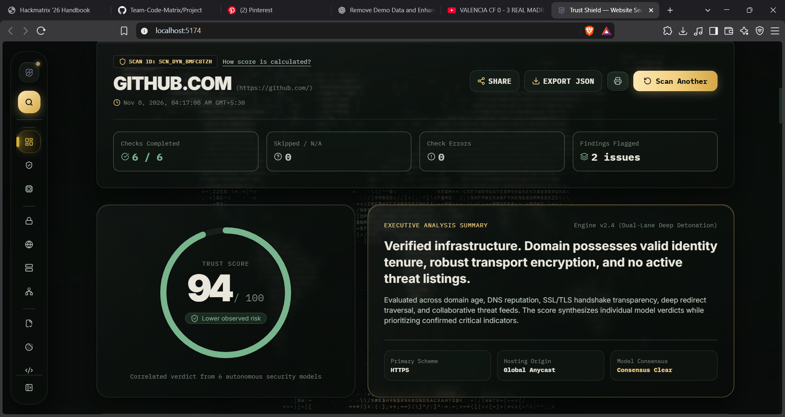

# Trust Shield

**AI-assisted website phishing detection and security assessment
platform.**

Trust Shield helps users investigate potentially unsafe websites by
combining URL and domain analysis, phishing heuristics, machine-learning
inference, TLS/certificate checks, web-security inspection, and
threat-intelligence context. It presents findings with risk explanations
and defensive recommendations.

> **Project status:** This repository contains a React/Vite frontend, a
> Python local API with an embedded ML inference path, and a separate
> Go/Kafka-based distributed backend architecture. The presence of an
> integration, worker, provider adapter, or UI module in the repository
> does not by itself mean that the service is fully operational in every
> deployment. Configure and test each dependency before describing it as
> live.

------------------------------------------------------------------------

## 01. Project name and one-line description

### Trust Shield

An intelligent website trust assessment platform designed to help users
identify phishing indicators, suspicious domains, certificate issues,
and web-security weaknesses before interacting with a website.

------------------------------------------------------------------------

## 02. Problem

Phishing pages, fake login portals, malicious redirects, brand
impersonation, and compromised websites can expose people and
organizations to credential theft, malware, financial fraud, and data
loss.

Many users cannot easily interpret technical signals such as domain
characteristics, TLS certificates, HTTP security headers, redirect
chains, or threat-intelligence reports. A single green padlock is not
enough to establish that a website is trustworthy.

Trust Shield aims to make these signals easier to investigate by
collecting technical evidence and presenting it in a structured,
understandable security assessment.

------------------------------------------------------------------------

## 03. Solution

Trust Shield accepts a URL and performs available security checks
through its analysis pipeline. The application is designed around the
following capabilities:

-   **URL and domain analysis:** URL normalization, suspicious lexical
    patterns, hostname checks, and domain-related indicators.
-   **Phishing and impersonation analysis:** Detection logic for
    suspicious page behavior, credential forms, and potential brand
    impersonation.
-   **TLS and certificate analysis:** Certificate retrieval and
    validation checks where supported by the active backend path.
-   **Web-security assessment:** Inspection of HTTP security headers,
    cookies, CORS behavior, and related web-security signals where
    implemented.
-   **Threat intelligence:** Correlation with configured threat feeds
    and external providers when credentials and provider access are
    available.
-   **Machine-learning inference:** The repository includes a trained
    Random Forest phishing model and feature-extraction/inference code.
-   **Risk explanation:** Findings should be presented with their
    source, evidence, status, and limitations. A missing provider result
    must be shown as unavailable---not treated as proof that a site is
    safe.
-   **Scan history and reports:** The application includes scan-history
    and reporting interfaces; persistence and export behavior depend on
    the configured backend implementation.

Trust Shield is an investigative aid. It does not guarantee that a
website is safe, and it is not a substitute for organizational security
controls or professional incident response.

------------------------------------------------------------------------

## 04. Demo links and a screenshot

-   **Live demo:** [https://trust-shield-zeta.vercel.app/](https://trust-shield-zeta.vercel.app/)
-   **Demo video:** Add the public demo-video URL here before
    submission.
-   **Repository:** [https://github.com/Team-Code-Matrix/Trust-Shield](https://github.com/Team-Code-Matrix/Trust-Shield)
-   **Screenshot:** Platform interface preview:



> Before submission, replace the placeholders with working public links
> and ensure the screenshot file is committed to the repository. Do not
> submit private, expired, or access-restricted demo links.

------------------------------------------------------------------------

## 05. Tech stack

### Frontend

-   **React 19** --- component-based user interface.
-   **TypeScript** --- typed application code and data contracts.
-   **Vite** --- development server and production build tooling.
-   **Tailwind CSS** --- utility-based styling.
-   **React Router** --- client-side routing.
-   **Framer Motion** --- interface animation.
-   **@xyflow/react** --- interactive threat-relationship graph
    components.
-   **Recharts** --- charts and data visualizations.
-   **Zod** --- runtime validation of structured data.
-   **Lucide React** --- icons.
-   **Vitest** --- frontend unit tests.
-   **Oxlint** --- linting.

### Backend and analysis

-   **Python 3** --- local API and analysis services.
-   **SQLite** --- local-mode persistence.
-   **scikit-learn** --- Random Forest machine-learning inference.
-   **NumPy and Joblib** --- model feature processing and artifact
    loading.
-   **Requests and urllib3** --- HTTP client functionality.
-   **Go** --- distributed API gateway implementation.
-   **Apache Kafka** --- asynchronous worker messaging in the
    distributed architecture.
-   **Redis Stack** --- caching and filter infrastructure in the
    distributed architecture.
-   **PostgreSQL with pgvector** --- relational and vector storage in
    the distributed architecture.
-   **Neo4j** --- threat-relationship graph storage in the distributed
    architecture.
-   **MinIO** --- S3-compatible artifact storage in the distributed
    architecture.
-   **Protocol Buffers** --- shared message contracts.

### External security services

External providers must be configured with valid credentials and tested
before they are described as active integrations. The architecture and
project documentation reference services and feeds such as Google Safe
Browsing, VirusTotal, URLhaus, PhishTank, OpenPhish, Certificate
Transparency sources, and STIX/TAXII-compatible threat intelligence.

Provider availability, API permissions, quotas, and terms of use vary.
The local SQLite setup does not require cloud API keys for its basic
local startup path.

------------------------------------------------------------------------

## 06. Architecture

Trust Shield has two backend execution paths in this repository.

### A. Local application path

The local development path is intended for running the React frontend
with the Python API and its local ML inference implementation.

``` text
Browser
   |
   v
React + TypeScript + Vite
   |
   | HTTP / WebSocket
   v
Python API (backend/server.py)
   |
   +--> URL validation and analysis
   |
   +--> Feature extraction
   |
   +--> Random Forest model inference
   |
   +--> Local SQLite database
   |
   +--> Scan results, history and report endpoints
```

### B. Distributed backend architecture

The repository also contains a Go gateway and a containerized
distributed architecture intended for asynchronous scanning.

``` text
React Frontend
      |
      | HTTP / WebSocket
      v
Go API Gateway
      |
      +--> Fast-path checks / Redis
      |
      +--> Kafka scan tasks
                |
        +-------+-------+-------+
        |       |       |       |
        v       v       v       v
      Pillar 1 Pillar 2 Pillar 3 Pillar 4
      Phishing  PKI     WebSec  Threat Intel
        |       |       |       |
        +-------+-------+-------+
                |
                v
        Result aggregation
                |
        +-------+---------+
        |       |         |
      Postgres Neo4j    MinIO
```

The distributed services are defined in `backend/docker-compose.yml`.
Treat this as a separate deployment path: start it only after reviewing
its configuration, environment variables, health checks, network
boundaries, and worker integration. Do not assume that the local Python
API automatically runs the entire distributed pipeline.

### Local API endpoints

The Python server documents routes including:

  Method   Endpoint                   Purpose
  -------- -------------------------- ---------------------------
  GET      `/healthz`                 Health check
  POST     `/api/v1/scan`             Submit a scan
  POST     `/api/v1/scan/fast-path`   Fast-path check
  GET      `/api/v1/scan/{id}`        Retrieve a scan
  GET      `/api/v1/scan/history`     Retrieve scan history
  GET      `/api/v1/threats`          Threat feed endpoint
  POST     `/api/v1/report`           Submit a community report
  POST     `/api/v1/auth/register`    Register a user
  POST     `/api/v1/auth/login`       Authenticate a user
  GET      `/api/v1/auth/me`          Retrieve current user
  POST     `/api/v1/ai/analyze`       ML analysis endpoint
  WS       `/ws/scans/{id}`           Scan telemetry stream

Check the running server's implementation and response schemas before
relying on any endpoint in a production integration.

------------------------------------------------------------------------

## 07. Setup and run steps

### Prerequisites

-   Git
-   Node.js **20.19+ recommended** (use a version supported by the
    installed Vite release)
-   npm
-   Python **3.10+**
-   Windows, macOS, or Linux

### 1. Clone the repository

``` bash
git clone https://github.com/Team-Code-Matrix/Trust-Shield.git TrustShield
cd TrustShield
```

Replace the repository URL if cloning from an alternate fork.

### 2. Configure the backend

``` bash
cd backend
python -m venv .venv
```

Activate the virtual environment:

**Windows PowerShell**

``` powershell
.venv\Scripts\Activate.ps1
```

**macOS / Linux**

``` bash
source .venv/bin/activate
```

Install dependencies:

``` bash
pip install -r requirements.txt
```

Create the local environment file:

**Windows PowerShell**

``` powershell
Copy-Item .env.example .env
```

**macOS / Linux**

``` bash
cp .env.example .env
```

Review `backend/.env` and set a unique, strong `JWT_SECRET` before using
the application beyond local testing. Never commit `.env`.

Start the API:

``` bash
python server.py
```

The local backend is expected at:

``` text
http://localhost:8000
```

Health check:

``` text
http://localhost:8000/healthz
```

### 3. Configure and start the frontend

Open a second terminal from the repository root:

``` bash
cd frontend
```

Install packages:

``` bash
npm install
```

Create the frontend environment file:

**Windows PowerShell**

``` powershell
Copy-Item .env.example .env.local
```

**macOS / Linux**

``` bash
cp .env.example .env.local
```

The default local API setting is:

``` env
VITE_API_BASE_URL=http://localhost:8000
```

Start the frontend:

``` bash
npm run dev
```

Open:

``` text
http://localhost:5173
```

### 4. Run checks

From `frontend/`:

``` bash
npm test
npm run lint
npm run build
```

### 5. Optional Windows launcher

From the repository root, run:

``` text
start.bat
```

The launcher installs dependencies when needed and opens separate
backend and frontend terminal windows. Review the script before use and
ensure your local environment configuration is secure.

### 6. Optional distributed infrastructure

The distributed services are defined in:

``` text
backend/docker-compose.yml
```

Review the Compose file and required secrets before starting it. The
infrastructure includes Kafka, PostgreSQL, Redis, Neo4j, MinIO, the Go
gateway, and four worker services. Configure persistent volumes, strong
credentials, restricted network access, and health checks before using
it outside a local development environment.

------------------------------------------------------------------------

## 08. Disclosures

### Libraries and open-source components

Trust Shield uses the libraries and frameworks listed in the Tech Stack
section. Their respective licenses and notices remain applicable. Review
package manifests and dependency licenses before redistribution or
commercial deployment.

### Templates and starter code

The frontend uses the React, TypeScript, and Vite project structure and
standard ecosystem tooling. Disclose any additional UI kits, templates,
starter repositories, icons, datasets, or copied code actually used by
the team. Do not claim original authorship of third-party assets.

### AI tools

AI-assisted development tools were used during the engineering of Trust Shield:
-   **ChatGPT (OpenAI)** --- used for initial project ideation, threat modeling, security architecture planning, and documentation drafting.
-   **Google Gemini** --- used for code pairing, algorithm design, full-stack synchronization, debugging, and unit test generation.

The **Random Forest model** (`backend/ml/models/trustshield_phishing_model.joblib`) is a custom-trained machine-learning model trained locally with `scikit-learn` on 15 deterministic lexical and domain features. It executes local probability inference (`predict_proba`) and operates independently of external LLM APIs.

### Data and API providers

List every external API, dataset, threat feed, and certificate source
actually used in the submitted build. Include applicable attribution,
licensing, rate-limit, and acceptable-use requirements. Do not publish
API keys, access tokens, passwords, or private URLs.

### Security and limitations

-   A scan result is an assessment based on the evidence available at
    scan time; it is not a guarantee of safety.
-   An unavailable provider or missing result must not be interpreted as
    a clean result.
-   External API coverage depends on credentials, service availability,
    quotas, and provider terms.
-   Do not scan systems without authorization.
-   The scanning infrastructure must enforce SSRF protections,
    private/reserved IP restrictions, redirect validation, request
    limits, and isolated execution for untrusted content before public
    deployment.
-   Replace development secrets and default credentials before
    deployment.
-   Verify all worker pipelines and external integrations in the target
    environment before claiming that they are operational.

------------------------------------------------------------------------

## 09. Track

**Suggested submission track:** Cybersecurity / Digital Safety / Trust &
Safety.

Trust Shield addresses phishing, website impersonation, malicious URL
detection, and web-security visibility. If the event provides an
official track list, replace this suggested label with the exact track
name used by the organizers.

------------------------------------------------------------------------

## Team

-   **Team Name:** Code Matrix
-   **Team Members:**
    -   **Arnab Ghorai** (Leader) --- [GitHub](https://github.com/AG349) • [LinkedIn](https://www.linkedin.com/in/arnab-ghorai-ag349)
    -   **Bikram Das** (Member 1) --- [GitHub](https://github.com/yyo298646-hub) • [LinkedIn](https://www.linkedin.com/in/bikram-das-sapstudent)
    -   **Ishika Mahto** (Member 2)
    -   **Srijit Deshmukh** (Member 3)
-   **Contact:**
    -   [arnabghorai349@gmail.com](mailto:arnabghorai349@gmail.com)
    -   [yyo298646@gmail.com](mailto:yyo298646@gmail.com)

------------------------------------------------------------------------

## License

No license has been specified in this repository documentation. Add a
`LICENSE` file and name the selected license before making the
repository available for reuse. Do not assume that public visibility
automatically grants permission to reuse the code.
